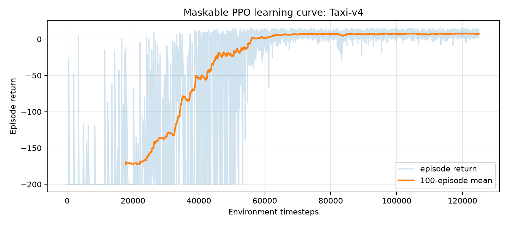

# Maskable PPO: Invalid Action Masking in Reinforcement Learning

## Project Overview

This project investigates the application of Maskable Proximal Policy Optimization (Maskable PPO) in an environment with state-dependent invalid actions.

The main objective is to train and evaluate a Maskable PPO agent in Gymnasium Taxi-v4 and demonstrate how action masking and policy optimization work in practice.

## Selected Environment

**Gymnasium Taxi-v4**

The agent controls a taxi on a 5x5 grid. Its objective is to pick up a passenger and deliver them to the correct destination.

- Observation space: `Discrete(500)`
- Action space: `Discrete(6)`
- Rewards: -1 per step, +20 for successful delivery, -10 for illegal pickup/dropoff
- Episode termination: successful delivery
- Episode truncation: maximum step limit

Taxi-v4 provides state-dependent action masks, making it suitable for applying and evaluating Maskable PPO.

## Algorithm

Maskable PPO is an on-policy actor-critic reinforcement learning algorithm that extends standard PPO with invalid action masking.

The algorithm uses:

- Actor network to represent the policy
- Critic network to estimate the state-value function
- State-dependent action masks to exclude invalid actions
- Generalized Advantage Estimation (GAE)
- PPO clipped objective for policy optimization

Invalid actions are excluded from the policy distribution before action selection. Action masks are also applied during policy optimization and evaluation.

The project uses the Maskable PPO implementation provided by `sb3-contrib`.

## Environment Compatibility

The environment has been tested with Gymnasium and sb3-contrib.

- ActionMasker wrapper: working
- Action mask retrieval: working
- Mask shape: `(6,)`
- State-dependent action masking: verified
- Masked action selection: verified
- Compatibility check: passed

## Training Configuration

The agent was trained on CPU using the following configuration:

| Parameter | Value |
|---|---|
| Policy | MlpPolicy |
| Learning rate | 0.0003 |
| Rollout size | 1024 |
| Batch size | 64 |
| Discount factor (gamma) | 0.99 |
| GAE lambda | 0.95 |
| Optimization epochs | 10 |
| Training budget | 125,000 timesteps |
| Evaluation frequency | 5,000 timesteps |
| Evaluation episodes per checkpoint | 20 |
| Random seed | 42 |

A MaskableEvalCallback was used to evaluate the agent during training and save the best-performing checkpoint.

The trained model is available in `models/maskable_ppo_taxi.zip`.

## Evaluation Results

The submitted model was evaluated over 100 episodes using deterministic action selection, fixed random seeds, and state-dependent action masks.

| Metric | Result |
|---|---|
| Mean episode reward | 7.31 |
| Reward standard deviation | 3.04 |
| Successful delivery rate | 100% |
| Mean episode length | 13.69 steps |
| Final rolling mean training reward (100 episodes) | 7.25 |

The agent successfully completed all 100 evaluation episodes without selecting invalid actions.

### Training Curve



### Agent Demonstration


The demonstration episode completes a successful passenger delivery in 13 steps with a total reward of 8.

## Numerical Policy Update Example

The project includes a small numerical example demonstrating how Maskable PPO updates its policy.

The example uses a real Taxi-v4 state and its corresponding action mask to demonstrate:

- Action probability distribution before and after masking
- Calculation of the PPO probability ratio
- Calculation of the clipped policy objective
- Gradient computation
- A policy update using gradient descent
- Updated action probabilities
- The effect of PPO clipping

After one illustrative optimization step, the probability of the selected valid action increases from 0.400000 to 0.444271, while invalid actions retain zero probability.

The numerical calculations are verified using PyTorch and automated assertions.

The example is available in `notebooks/05_ppo_numerical_update.ipynb` and is also included in the final project notebook.

## Project Structure

```text
MaskablePPO-Project/
├── models/
│   └── maskable_ppo_taxi.zip
├── notebooks/
│   ├── 01_environment_setup.ipynb
│   ├── 02_action_masking.ipynb
│   ├── 03_ppo_algorithm.ipynb
│   ├── 04_training_model.ipynb
│   ├── 05_ppo_numerical_update.ipynb
│   └── 06_final_maskable_ppo_taxi.ipynb
├── results/
│   ├── taxi_demo.gif
│   └── training_curve.png
├── .gitignore
├── README.md
└── requirements.txt
```

## Notebook Description

| Notebook | Description |
|---|---|
| `01_environment_setup.ipynb` | Environment setup and compatibility checks |
| `02_action_masking.ipynb` | State-dependent action masking and validation |
| `03_ppo_algorithm.ipynb` | PPO and Maskable PPO algorithm explanation |
| `04_training_model.ipynb` | Agent training, evaluation, and visualization |
| `05_ppo_numerical_update.ipynb` | Step-by-step numerical policy update example |
| `06_final_maskable_ppo_taxi.ipynb` | Complete project pipeline and final results |

## Installation

Python 3.12 is recommended.

Create and activate a Python virtual environment:

```bash
python3.12 -m venv .venv
source .venv/bin/activate
pip install -r requirements.txt
```

Verify the installed dependencies:

```bash
pip check
```

## Run

Open `notebooks/06_final_maskable_ppo_taxi.ipynb` in VS Code or Jupyter and execute all cells using the configured Python environment.

By default, the notebook uses the pretrained model:

```python
RUN_TRAINING = False
```

This allows the environment, action masking, trained agent, evaluation results, and numerical policy update to be examined without retraining the model.

The individual notebooks can also be opened separately to explore specific project components.

## Retraining the Agent

The final notebook also supports training the Maskable PPO agent from scratch.

To retrain the agent:

1. Install the dependencies as described in the Installation section.
2. Open `notebooks/06_final_maskable_ppo_taxi.ipynb`.
3. Change the training configuration to:

   ```python
   RUN_TRAINING = True
   ```

4. Restart the notebook kernel and execute all cells.

The agent will be trained on CPU using the original configuration with a training budget of 125,000 timesteps and a random seed of 42.

During training, the MaskableEvalCallback evaluates the agent every 5,000 timesteps and saves the best-performing checkpoint.

The new model and training logs are saved in a separate directory:

```text
reproduced_run/
├── models/
│   ├── best/
│   │   └── best_model.zip
│   └── maskable_ppo_taxi.zip
└── results/
    ├── training_monitor.monitor.csv
    └── evaluation/
        └── evaluations.npz
```

The original submitted model and results are not overwritten.

Although the same random seed and hyperparameters are used, minor differences in evaluation results may occur due to hardware, operating system, or library-level numerical differences.

The final notebook contains assertions that verify the original submitted model's evaluation results. These assertions may need to be adjusted when evaluating a newly trained model.

The training curve and demonstration GIF displayed in the final notebook correspond to the original training run.

Retraining is optional and is not required to evaluate the submitted model or examine the numerical policy update example.

## References

- Schulman et al., [Proximal Policy Optimization Algorithms](https://arxiv.org/abs/1707.06347)
- [SB3 Contrib: Maskable PPO](https://sb3-contrib.readthedocs.io/en/master/modules/ppo_mask.html)
- [Gymnasium: Taxi](https://gymnasium.farama.org/environments/toy_text/taxi/)
 
## Project Status

- [x] Environment selection and setup
- [x] Action mask verification
- [x] Maskable PPO interface compatibility check
- [x] Action masking implementation
- [x] PPO algorithm explanation
- [x] Maskable PPO agent training
- [x] Performance evaluation
- [x] Training curve visualization
- [x] Trained agent demonstration
- [x] Numerical policy update example
- [x] Final project notebook
- [x] Dependency installation verification
